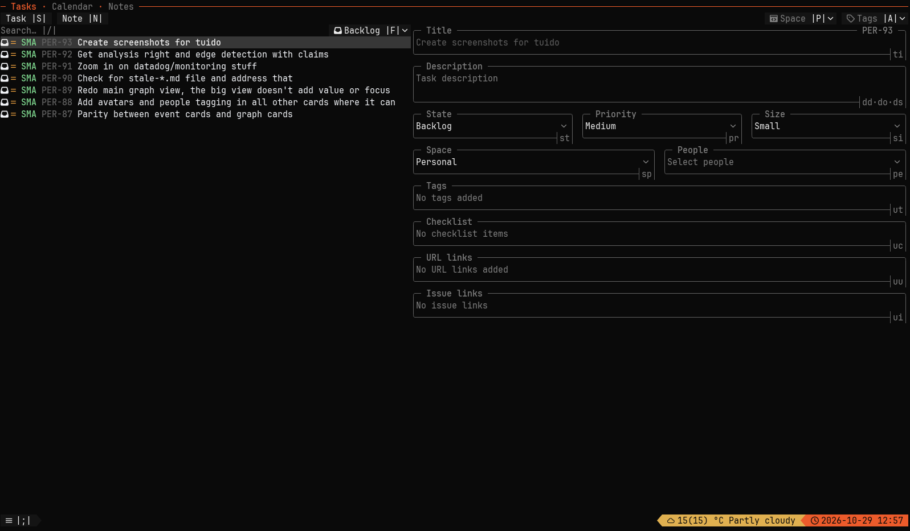
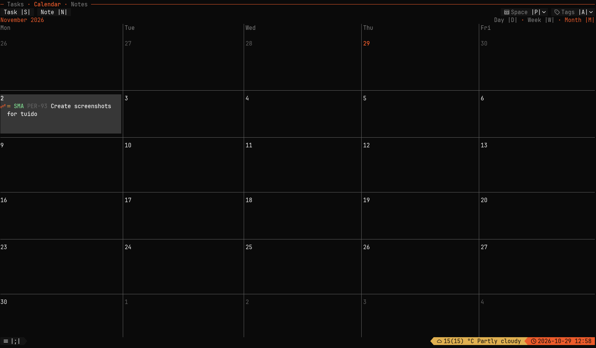
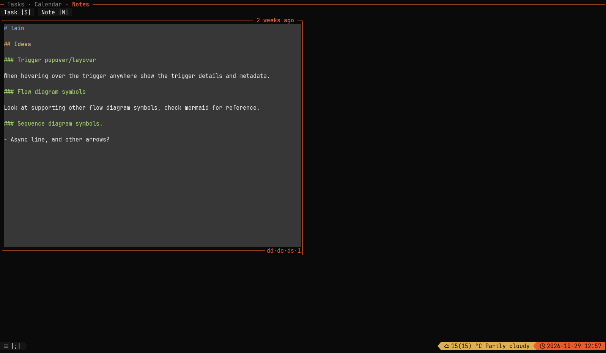

# Tuido

MCP-driven task management with a keyboard-first terminal UI.

[](https://github.com/daure/tuido/releases/latest)
[](https://github.com/daure/tuido/actions/workflows/release.yml)

[Install](#install) · [Get started](#get-started) · [MCP](#connect-an-agent) · [Reference](docs/reference.md)

Agents use [Model Context Protocol](https://modelcontextprotocol.io/) (MCP) to query, create, update, and delete tasks, notes, spaces, tags, and people. They can also manage task checklists, links, relations, and workflow states. The TUI and agents share the same database: local SQLite by default, or Postgres.

## Features

- Tasks with descriptions, checklists, priorities, sizes, and relations.
- Spaces, tags, and people to organize work.
- Notes for context that is not yet a task.

## Screenshots



<sub>Tasks — browse your backlog and edit task details, priority, size, and state.</sub>



<sub>Calendar — see snoozed tasks in a month view.</sub>



<sub>Notes — capture project context and ideas in Markdown.</sub>

## Install

**Ubuntu 24.04+, x86_64.** Use a [Nerd Font](https://www.nerdfonts.com/) for icons.

```sh
installer="$(mktemp)"
curl --proto '=https' --tlsv1.2 -LsSf \
  https://github.com/daure/tuido/releases/latest/download/tuitodo-installer.sh \
  -o "$installer" && sh "$installer"
rm -f "$installer"
export PATH="${CARGO_HOME:-$HOME/.cargo}/bin:$PATH"
tuido
```

Release assets use the package name `tuitodo`; the executable is `tuido`.
Keep `${CARGO_HOME:-$HOME/.cargo}/bin` on your PATH. Close TUIs and back up your database before upgrades or rollbacks; see [installation and updates](docs/reference.md#install).

## Get started

1. Press `Shift+S` to create a task.
2. Set its priority and size; add a description or checklist as needed.
3. Move it through backlog, todo, in-progress, and done.

The TUI shows configured shortcuts; these are the defaults. Edits save immediately.
Linux data defaults to `~/.local/share/tuido`. Set `TUIDO_DATABASE_URL` to select another database; see [configuration](docs/reference.md#development).

## Connect an agent

Configure a local stdio MCP server:

```json
{
  "command": "tuido",
  "args": ["mcp"]
}
```

The client manages the process; no service is required.
For HTTP, see the [MCP service guide](docs/reference.md#persistent-mcp-service). HTTP is loopback-only with no bearer authentication.

## Documentation and contributing

- [Build from source](docs/reference.md#build-from-source) — Rust and a sibling `../tuicore` checkout
- [Development and configuration](docs/reference.md#development)
- [Architecture](architecture.md) · [Verification and releases](docs/reference.md#release)
- [Issues](https://github.com/daure/tuido/issues)

## License

[MIT](LICENSE-MIT) or [Apache-2.0](LICENSE-APACHE), at your option.
